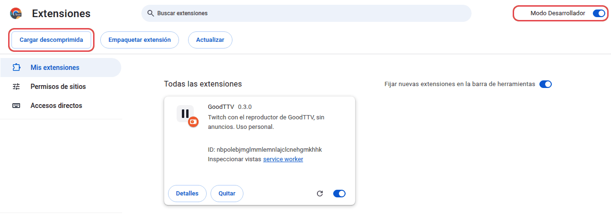

# GoodTTV

[English](README.md) · **Español**

Twitch sin anuncios, con apps propias: una extensión para el navegador, una app de Android y otra para la tele. Las
tres comparten el código que quita los anuncios, la cuenta y el chat.

> [!WARNING]
> Quitar los anuncios incumple las condiciones de servicio de Twitch. GoodTTV es un proyecto personal: úsalo bajo tu
> responsabilidad. No está en ninguna tienda y no tiene relación con Twitch.

| App | Para qué | Estado |
| --- | --- | --- |
| [Navegador](#navegador) (`apps/navegador`) | Chrome, Chromium, Firefox y Zen, con ratón y teclado | 0.3.0 |
| [Android](#android) (`apps/android`) | Teléfonos con Android 13 o posterior | 0.3.0, experimental |
| [Tele](#tele) (`apps/tele`) | Un mini PC Linux conectado a la tele, con un mando | 0.3.0, ya no se prueba en una tele |


## Lo nuevo de la 0.3.0

- **Los VOD**, en la extensión y en Android: una barra con miniaturas, la velocidad, el chat tal como se escribió en
  el directo, y siguen donde los dejaste.
- **Retroceder un directo** hasta su principio, y volver con «Ir al directo». ← y → mueven 10 s.
- **Escribir en el chat**, con los emotes de 7TV, BTTV, FFZ y los tuyos de Twitch. Para permitirlo hay que volver a
  vincular la cuenta.
- **Buscar como en twitch.tv**, por relevancia y con erratas, sin cuenta.
- **Varias pestañas a la vez**, cada una con su canal. Solo suena la última que miraste.
- **Inicio sale antes**, y ya no enseña canales de una sesión pasada como si estuvieran en directo.
- **La primera versión de Android**, experimental.

## Cómo quita los anuncios

Twitch mete los anuncios dentro de la propia emisión, y cada sesión de espectador los recibe por separado. GoodTTV:
- abre a la vez varias sesiones de invitado del mismo canal: la del reproductor web, la del incrustado, la de la
  ventana emergente y la de la app de Android;
- toma cada fragmento de vídeo de una sesión que no esté en anuncio y los empalma por la numeración común que les
  pone Twitch;
- si todas están en anuncio a la vez, rellena con la grabación del directo (el VOD) hasta que vuelve la emisión.

El relleno necesita que el canal tenga el VOD público y que llegue a tiempo; si no, la imagen se queda quieta mientras
dura la pausa. Hay tres modos de retraso: Adaptativo (por defecto), Sin paradas y Directo. El chat se retrasa lo mismo
que la imagen, para que vayan más o menos a la par.

En la extensión, con varios canales y 12 arranques, la primera imagen llega en 0,86 s (mediana) y se pierde el 0,06 %
de los fotogramas, sin paradas ([detalle](docs/verificacion.md#rendimiento-del-reproductor-propio)).

## Navegador

Una extensión que abre GoodTTV en una pestaña propia, pensada para el ratón y el teclado. El mismo código sirve para
Chrome y para Firefox.


- **Inicio:** tus seguidos en directo, los canales que viste los últimos, los VOD que dejaste a medias y los populares.
- **Una columna con tus seguidos en directo,** por espectadores o, como el «Recomendado para ti» de Twitch, por lo que
  ves cada uno. Se puede plegar.
- **La búsqueda siempre arriba** (`/`), por relevancia, como en twitch.tv.
- **El canal:** los controles van encima del vídeo y se ocultan con el ratón quieto: calidad, modo teatro (`T`),
  pantalla completa (`F`), chat (`C`) y silencio (`M`). ↑/↓ cambian de canal, ←/→ mueven 10 s y `Fin` vuelve al
  directo. Si el canal guarda su VOD, la barra llega hasta el principio de la emisión.
- **El chat**, con los emotes de 7TV, BTTV, FFZ y Twitch. Al pasar el ratón por un emote, dice su nombre. Para
  escribir, `Tab` y `:` completan emotes, o puedes elegirlos de una lista.
- **Los VOD**, debajo de cada canal. Se abren en la mejor calidad que aguanta tu conexión, siguen 5 s antes de donde
  los dejaste y llevan su chat a la par de la imagen.
- **«Siguiendo»**, en un canal que sigues. Seguir y dejar de seguir abren twitch.tv: la API de Twitch ya no lo permite.
- **Varias pestañas**, cada una con su canal. Suena solo la última que miraste; las demás esperan, y volver a ellas
  tarda ~0,1 s los primeros minutos.
- **Arranca antes** si dejas el ratón quieto sobre un canal: lo va preparando.
- **«Abrir en GoodTTV»** en el menú contextual de los enlaces de twitch.tv.


**Instalarla:** no está en las tiendas. Descarga `goodttv-0.3.0.xpi` de las
[releases](https://github.com/mateozariquiey/GoodTTV/releases).
- **Zen** (y Firefox Developer Edition o Nightly): en `about:config`, pon `xpinstall.signatures.required` a
  `false`. Después, en `about:addons`, menú del engranaje → «Instalar complemento desde archivo…».
- **Firefox:** solo admite complementos sin firmar de forma temporal: `about:debugging` → «Este Firefox» → «Cargar
  complemento temporal…». Se quita al cerrar Firefox.
- **Chrome y Chromium,** también en Windows:
  1. El `.xpi` es un ZIP. Descomprímelo en una carpeta que vayas a conservar. En Windows, cámbiale la extensión a
     `.zip` y usa «Extraer todo», o ábrelo con 7-Zip.
  2. En `chrome://extensions`, activa el «Modo Desarrollador» (arriba a la derecha).
  3. Pulsa «Cargar descomprimida» y elige esa carpeta.

  No muevas ni borres la carpeta después: Chrome carga la extensión desde ella. Para actualizarla, descomprime la
  versión nueva en la misma carpeta y pulsa la flecha de recargar en la tarjeta de GoodTTV.

  

Para compilarla, `bun run build:navegador` (deja la extensión en `apps/navegador/dist`) o `bun run pack:navegador`
(el `.xpi`). Más en [docs/desarrollo.md](docs/desarrollo.md#extensión-de-navegador).

## Android

**Experimental.** Lo mismo para quitar los anuncios, la cuenta y el chat, con pantallas para el dedo: Inicio, la
búsqueda, el canal con su chat y sus vídeos, los VOD y retroceder el directo. El vídeo va con el reproductor propio de
Android (Media3) y sigue sonando con la pantalla apagada, con sus controles en la notificación, en la pantalla de
bloqueo y en los auriculares. Como en la app de Twitch, el canal que dejas sigue en una esquina, deslizar hacia abajo
sobre el vídeo vuelve atrás, y al salir de la app pasa a imagen en imagen.

<p>
  
  
</p>

Solo se ha probado en un teléfono (un Galaxy S25 Ultra con Android 16). Que el chat vaya a la par de la imagen se ha
comprobado a ojo, sin medirlo.

**Instalarla** (Android 13 o posterior): descarga `GoodTTV-0.3.0.apk` de las
[releases](https://github.com/mateozariquiey/GoodTTV/releases) en el teléfono y ábrelo. Android te pedirá permiso para
instalar apps desde el navegador o el gestor de archivos, y Play Protect puede avisar de que no conoce al
desarrollador. Las versiones nuevas se instalan encima de la anterior y conservan la cuenta, porque van firmadas con la
misma clave. Desde un ordenador, `adb install -r GoodTTV-0.3.0.apk` hace lo mismo. La huella SHA-256 del certificado de
la firma es `38:CF:EA:F9:1C:2F:8C:C4:B8:35:27:11:BD:77:7F:56:0E:A8:D5:4F:87:37:C4:91:6C:B6:BA:C8:27:32:5A:D6` (la enseña `apksigner verify --print-certs`).

Para compilarla hacen falta el SDK de Android y un JDK 21: lo explica [apps/android/README.md](apps/android/README.md).

## Tele

Pensada para usarla desde el sofá en un mini PC Linux con un mando pequeño: flechas, OK, Atrás y Reproducir/Pausa.
Sirve para ver los directos de los canales que sigues, buscar canales y leer el chat con los emotes de 7TV, BTTV, FFZ y
Twitch. Los VOD, retroceder y escribir en el chat de las otras apps no están aquí.

**Estado:** desde octubre de 2026 ya no funciona en una tele de verdad. Se sigue compilando y comprobando con las
pruebas automáticas (unitarias y de extremo a extremo, en Electron), pero nadie la usa a diario. La 0.2.2 fue la última
probada en el mini PC con su mando: el audio por HDMI, la decodificación de vídeo por hardware (VA-API), el mando y la
legibilidad a 3 m ([detalle](docs/verificacion.md#en-el-mini-pc-la-tv-y-el-mando)).


De la 0.1.0, con el reproductor oficial de Twitch: [reproducción](docs/media/reproduccion.jpg) ·
[vídeo de demostración (84 s, solo teclas de mando)](docs/media/demo.mp4) ·
[buscar con el teclado en pantalla](docs/media/buscar.jpg) · [selector de calidad](docs/media/calidad.jpg)

- **Inicio tipo guía:** a la izquierda, los canales que sigues en directo, y debajo los que viste hace poco y los
  populares; a la derecha, una vista previa grande del enfocado.
- **Reproductor propio, sin anuncios,** a todo el alto y con el chat a la derecha. El título y los controles aparecen
  al pulsar una tecla y se ocultan solos. ↑/↓ cambian de canal sin salir del reproductor, y Reproducir/Pausa funciona
  siempre. Si falla, se puede cambiar al reproductor oficial de Twitch.
- **Buscar** con un teclado en pantalla manejado con el mando. Si conectas un teclado físico, también sirve.
- **Volver conserva tu sitio:** al salir del reproductor, el foco vuelve al canal del que venías.
- **Vincular la cuenta con el móvil,** con un QR o un código de Twitch. Solo pide permisos de lectura: tus seguidos y
  el chat.

| Mando | Acción |
| --- | --- |
| Flechas | Moverse. En el reproductor, ↑/↓ cambian de canal |
| OK (Enter) | Elegir |
| Atrás (Escape, Back, Retroceso) | Volver |
| Reproducir/Pausa (o Espacio) | Pausar o reanudar en cualquier momento |

**Instalarla:** descarga el AppImage de las [releases](https://github.com/mateozariquiey/GoodTTV/releases) (Linux
x86_64) y ejecútalo; arranca a pantalla completa y necesita `libfuse2`. Para compilarla:

```bash
bun install --frozen-lockfile
bun run build && bun run start   # en una ventana, para probar
bun run package:appimage         # apps/tele/dist/GoodTTV-0.3.0-x86_64.AppImage
```

## El código

Un monorepo con espacios de trabajo de Bun:

| Carpeta | Qué hay |
| --- | --- |
| `apps/navegador` | La extensión (Manifest V3) |
| `apps/android` | La app de Android (Kotlin y la interfaz web, compiladas con Gradle; no es un espacio de trabajo de Bun) |
| `apps/tele` | La app de la tele (Electron) |
| `packages/sin-anuncios` | El empalme de las sesiones y el relleno con el VOD |
| `packages/interfaz` | Lo común de las interfaces: reproductor, chat y datos |
| `packages/servicios` | Cuenta, API de Twitch (Helix), chat y almacén |
| `packages/contratos` | Los tipos de la API que comparten las apps |

Requisitos: Node.js 24 o posterior y Bun 1.4.2.

```bash
bun install --frozen-lockfile
bun run verify   # Biome, TypeScript, pruebas unitarias y compilaciones (Android se compila aparte, con Gradle)
```

La documentación de diseño está en español: [arquitectura](docs/arquitectura.md), [decisiones](docs/decisiones.md),
[desarrollo](docs/desarrollo.md) y [verificación](docs/verificacion.md). Algunas rutas que citan (`investigacion/`,
`herramientas/`, `.lab/`) son del repo de trabajo y no se publican.

## Origen

GoodTTV empezó como una variante de [VacuumStream](https://github.com/eliottness/VacuumStream) 0.2.1, de Eliott
Bouhana, con licencia MIT. Este repositorio conserva su historial completo. De VacuumStream se conserva, en la tele:
- el proceso principal y su modelo de seguridad: aislamiento, IPC verificado y servidor HTTPS local con certificado
  fijado;
- el inicio de sesión por código y el almacén de tokens;
- el adaptador de Helix y el cargador del SDK de Twitch;
- el algoritmo de foco espacial y el empaquetado con electron-builder.

Lo demás es de GoodTTV: las interfaces de la tele, del escritorio y del teléfono, el chat con emotes de terceros, el
reproductor sin anuncios, la extensión y la app de Android. El porqué de cada decisión está en
[docs/decisiones.md](docs/decisiones.md).

## Contribuir

Se agradecen issues y pull requests, en español o en inglés. Consulta [CONTRIBUTING.md](CONTRIBUTING.md) y, para
avisos de seguridad, [SECURITY.md](SECURITY.md).

## Licencia

[MIT](LICENSE), con la atribución original de VacuumStream. Twitch es una marca de Twitch Interactive, Inc. GoodTTV no
está afiliado a Twitch ni cuenta con su respaldo. Los emotes de terceros se cargan desde los servicios públicos de 7TV,
BetterTTV y FrankerFaceZ.
