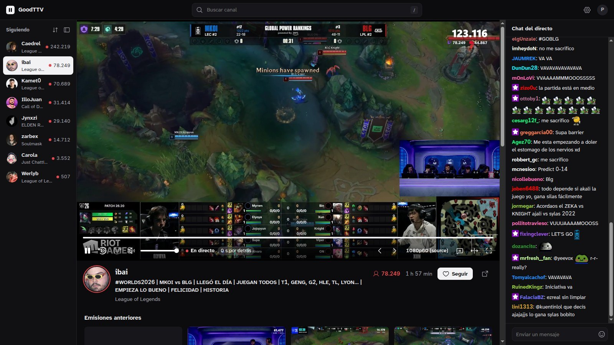
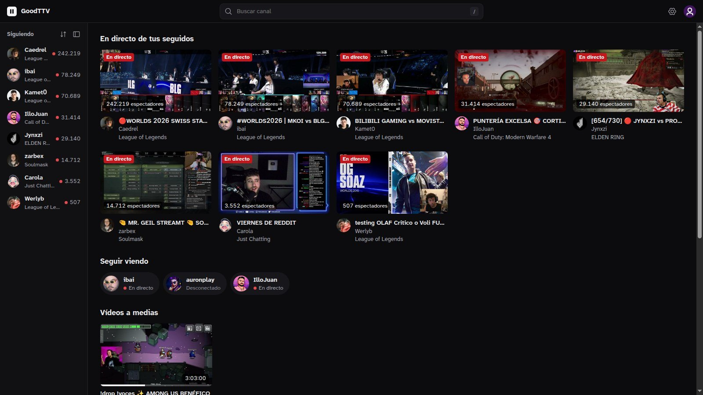
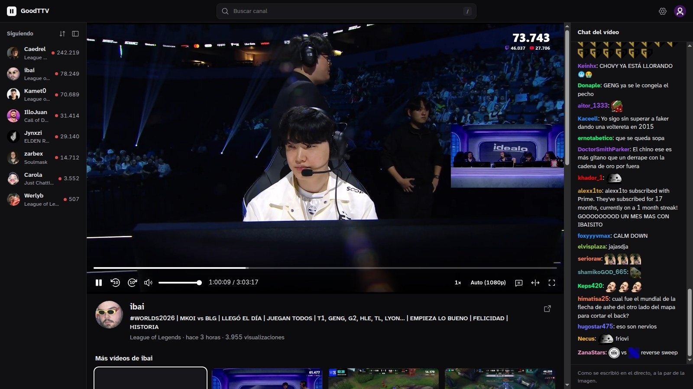
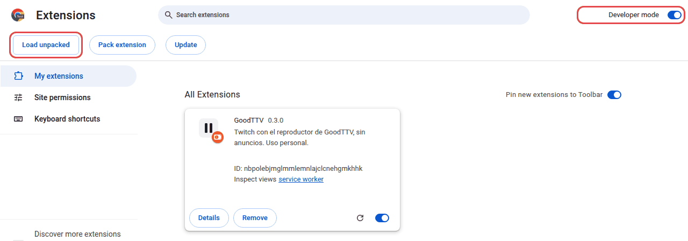
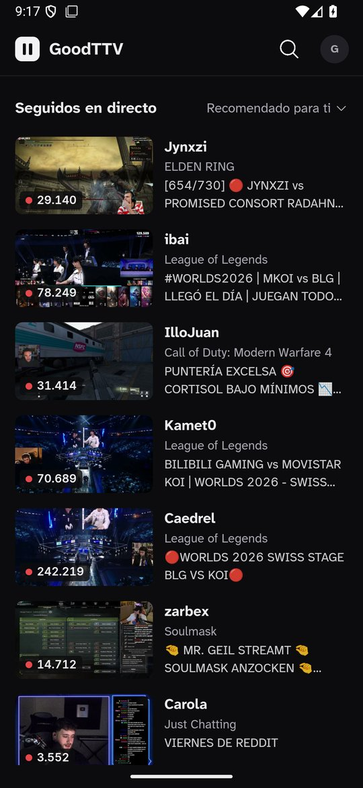
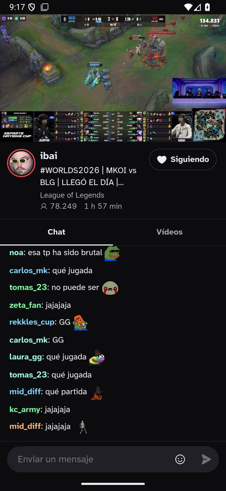
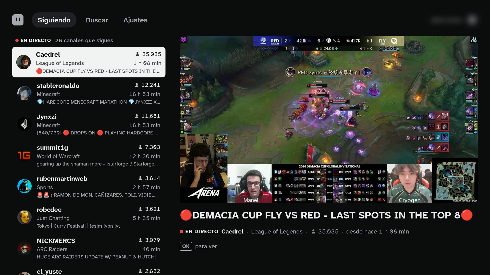

# GoodTTV

**English** · [Español](README.es.md)

Twitch without ads, in apps of its own: a browser extension, an Android app and a TV app. The three share the code
that removes the ads, the account and the chat.

> [!WARNING]
> Removing ads breaks Twitch's terms of service. GoodTTV is a personal project: use it at your own risk. It is not in
> any store and has no relationship with Twitch.

| App | For | Status |
| --- | --- | --- |
| [Browser](#browser) (`apps/navegador`) | Chrome, Chromium, Firefox and Zen, with mouse and keyboard | 0.4.0 |
| [Android](#android) (`apps/android`) | Phones with Android 13 or later | 0.4.0, experimental |
| [TV](#tv) (`apps/tele`) | A Linux mini PC connected to the TV, with a remote | 0.4.0, no longer tested on a real TV |

The interfaces are in Spanish for now.



## New in 0.4.0

- **Audio only with the screen off,** on Android: the channel switches to Twitch's audio-only stream without a gap, and
  the picture is back by the time you unlock. About 0.4 Mbit/s instead of 8: some 175 MB an hour instead of 3.7 GB.
- **Chat takes less work to draw:** with a busy chat, the extension's page thread goes from 10.5 % to 7.6 % of a core,
  and Android's web view from 30 % to 24 %.
- **Android opens the last channel you watched sooner,** in about 0.5 s instead of 1.6 s: it gets it ready when the app
  opens.
- **The quality is remembered,** like the volume, with "Auto" in the menu, and rewinding to the VOD keeps it.
- **Full screen with its own chat:** `C` puts it beside the video and it is remembered. Theater mode is for the window.
  On Android, the chat in landscape is remembered too.
- **Picture-in-picture** in the extension, in Chrome, Firefox and Zen.
- **Fixes:** long pauses and "Ir al directo", VODs in fMP4 that started in low quality, Space after a click, and on
  Android, rewinding at full screen and the VOD speed.

## How it removes ads

Twitch inserts ads into the stream itself, and each viewer session gets them separately. GoodTTV:
- opens several guest sessions of the same channel at once: the web player's, the embedded player's, the popout's and
  the Android app's;
- takes each video segment from a session that is not showing an ad and splices them together using the sequence
  numbers Twitch gives them;
- if every session is in an ad at the same time, fills the gap with the stream's recording (the VOD) until the
  broadcast is back.

The fill needs the channel's VOD to be public and to arrive in time; otherwise the picture freezes while the break
lasts. There are three delay modes: Adaptive (the default), No stalls and Live. Chat is delayed as much as the
picture, so they stay roughly in step.

In the extension, across several channels and 12 starts, the first frame arrives in 0.86 s (median) and 0.06 % of
frames are dropped, with no stalls ([details](docs/verificacion.md#rendimiento-del-reproductor-propio), in Spanish).

## Browser

An extension that opens GoodTTV in a tab of its own, made for mouse and keyboard. The same code runs in Chrome and
Firefox.



- **Home:** your followed channels that are live, the channels you watched last, the VODs you left halfway and popular
  streams.
- **A column with your followed channels that are live,** sorted by viewers or, like Twitch's "Recommended for you",
  by how much you watch each one. It can be collapsed.
- **Search always at the top** (`/`), ranked like twitch.tv's.
- **The channel:** the controls sit on top of the video and hide when the mouse rests: quality, theater mode (`T`),
  full screen (`F`, with its own chat beside it), chat (`C`), picture-in-picture and mute (`M`). ↑/↓ switch channel,
  ←/→ move 10 s and `End` goes back to live. If the channel keeps its VOD, the bar reaches back to the start of the
  broadcast. The volume and the quality are remembered, in other tabs too.
- **Chat** with 7TV, BTTV, FFZ and Twitch emotes. Hovering an emote shows its name. To write, `Tab` and `:` complete
  emotes, or you can pick them from a list.
- **VODs** below each channel. They open in the best quality your connection allows, pick up 5 s before where you
  left off, and show their chat in step with the picture.
- **"Siguiendo"** on a channel you follow. Following and unfollowing open twitch.tv: Twitch's API no longer allows it.
- **Several tabs**, each with its own channel. Only the last one you looked at plays sound; the others wait, and coming
  back takes about 0.1 s during the first few minutes.
- **Starts sooner** when the mouse rests on a channel: it gets it ready.
- **"Abrir en GoodTTV"** (open in GoodTTV) in the context menu of twitch.tv links.



**Install:** it is not in the stores. Download it from the
[releases](https://github.com/mateozariquiey/GoodTTV/releases).
- **Zen** (and Firefox Developer Edition or Nightly), with `goodttv-0.4.0.xpi`: in `about:config`, set
  `xpinstall.signatures.required` to `false`. Then, in `about:addons`, gear menu → "Install Add-on From File…".
- **Firefox:** it only accepts unsigned add-ons temporarily: `about:debugging` → "This Firefox" → "Load Temporary
  Add-on…" and the `.xpi`. It is removed when Firefox closes.
- **Chrome and Chromium,** on Windows too, with `goodttv-0.4.0-chrome.zip`:
  1. Unzip it into a folder you will keep.
  2. In `chrome://extensions`, turn on "Developer mode" (top right).
  3. Click "Load unpacked" and choose that folder.

  Do not move or delete the folder afterwards: Chrome loads the extension from it. To update, unzip the new version
  into the same folder and press the reload arrow on the GoodTTV card.

  

To build it, `bun run build:navegador` (the extension ends up in `apps/navegador/dist`) or `bun run pack:navegador`
(the `.xpi`). More in [docs/desarrollo.md](docs/desarrollo.md#extensión-de-navegador) (in Spanish).

## Android

**Experimental.** The same ad removal, account and chat, with screens made for touch: Home, search, the channel with
its chat and videos, VODs and rewinding live. Video plays with Android's own player (Media3) and keeps going with the
screen off, audio only to save data, with its controls in the notification, on the lock screen and on headphones. As
in Twitch's app, a channel you leave keeps playing in a corner, swiping down on the video goes back, and leaving the
app turns it into picture-in-picture.

<p>
  
  
</p>

It has been tested on one phone only (a Galaxy S25 Ultra with Android 16). Whether chat stays in step with the picture
has been checked by eye, not measured.

**Install** (Android 13 or later): download `GoodTTV-0.4.0.apk` from the
[releases](https://github.com/mateozariquiey/GoodTTV/releases) on the phone and open it. Android will ask you to allow
installing apps from the browser or the file manager, and Play Protect may warn that it does not know the developer.
New versions install over the old one and keep your account, because they are signed with the same key. From a
computer, `adb install -r GoodTTV-0.4.0.apk` does the same. The signing certificate's SHA-256 fingerprint is
`38:CF:EA:F9:1C:2F:8C:C4:B8:35:27:11:BD:77:7F:56:0E:A8:D5:4F:87:37:C4:91:6C:B6:BA:C8:27:32:5A:D6` (`apksigner verify --print-certs` shows it).

To build it you need the Android SDK and JDK 21: see [apps/android/README.md](apps/android/README.md) (in Spanish).

## TV

Made to be used from the couch on a Linux mini PC with a small remote: arrows, OK, Back and Play/Pause. Watch the live
channels you follow, search for channels, and read chat with 7TV, BTTV, FFZ and Twitch emotes. The VODs, rewinding and
writing in chat of the other apps are not here.

**Status:** since October 2026 it no longer runs on a real TV. It is still built and checked with the automated tests
(unit and end-to-end, in Electron), but nobody uses it day to day. 0.2.2 was the last version tested on the mini PC with
its remote: HDMI audio, hardware video decoding (VA-API), the remote and readability from 3 m
([details](docs/verificacion.md#en-el-mini-pc-la-tv-y-el-mando), in Spanish).



From 0.1.0, with Twitch's official player: [playback](docs/media/reproduccion.jpg) ·
[demo video (84 s, remote keys only)](docs/media/demo.mp4) ·
[search with the on-screen keyboard](docs/media/buscar.jpg) · [quality chooser](docs/media/calidad.jpg)

- **Guide-style home:** on the left, the channels you follow that are live, then the ones you watched recently and
  popular streams; on the right, a large preview of the focused one.
- **Its own ad-free player,** full height, with chat on the right. The title and controls appear when you press a key
  and hide by themselves. ↑/↓ switch channel without leaving playback, and Play/Pause always works. If it fails, you can
  switch to Twitch's official player.
- **Search** with an on-screen keyboard driven by the remote; a physical keyboard works too.
- **Back keeps your place:** leaving playback returns focus to the channel you came from.
- **Account linking from your phone,** with a QR code or a Twitch code. It only asks for read access: your follows and
  chat.

| Remote | Action |
| --- | --- |
| Arrows | Move. During playback, ↑/↓ switch channel |
| OK (Enter) | Select |
| Back (Escape, Back, Backspace) | Go back |
| Play/Pause (or Space) | Pause or resume at any time |

**Install:** download the AppImage from the [releases](https://github.com/mateozariquiey/GoodTTV/releases) (Linux
x86_64) and run it; it starts full screen and needs `libfuse2`. To build it:

```bash
bun install --frozen-lockfile
bun run build && bun run start   # in a window, for testing
bun run package:appimage         # apps/tele/dist/GoodTTV-0.4.0-x86_64.AppImage
```

## The code

A monorepo with Bun workspaces:

| Folder | Contents |
| --- | --- |
| `apps/navegador` | The extension (Manifest V3) |
| `apps/android` | The Android app (Kotlin and the web interface, built with Gradle; not a Bun workspace) |
| `apps/tele` | The TV app (Electron) |
| `packages/sin-anuncios` | Session splicing and VOD fill |
| `packages/interfaz` | What the interfaces share: player, chat and data |
| `packages/servicios` | Account, Twitch API (Helix), chat and storage |
| `packages/contratos` | The API types shared by every app |

Requirements: Node.js 24 or later and Bun 1.4.2.

```bash
bun install --frozen-lockfile
bun run verify   # Biome, TypeScript, unit tests and builds (Android is built apart, with Gradle)
```

The design documents are in Spanish: [architecture](docs/arquitectura.md), [decisions](docs/decisiones.md),
[development](docs/desarrollo.md) and [verification](docs/verificacion.md). Some paths they mention
(`investigacion/`, `herramientas/`, `.lab/`) belong to the working repo and are not published.

## Origin

GoodTTV started as a variant of [VacuumStream](https://github.com/eliottness/VacuumStream) 0.2.1 by Eliott Bouhana,
MIT licensed. This repository keeps its full history. From VacuumStream, the TV app keeps:
- the main process and its security model: isolation, verified IPC and a local HTTPS server with a pinned
  certificate;
- code-based sign-in and the token store;
- the Helix adapter and the Twitch SDK loader;
- the spatial focus algorithm and packaging with electron-builder.

The rest is GoodTTV's own: the TV, desktop and phone interfaces, chat with third-party emotes, the ad-free player, the
extension and the Android app. The reasons behind each decision are in [docs/decisiones.md](docs/decisiones.md).

## Contributing

Issues and pull requests are welcome, in English or Spanish. See [CONTRIBUTING.md](CONTRIBUTING.md) and, for security
reports, [SECURITY.md](SECURITY.md).

## License

[MIT](LICENSE), keeping VacuumStream's original attribution. Twitch is a trademark of Twitch Interactive, Inc. GoodTTV
is not affiliated with or endorsed by Twitch. Third-party emotes are loaded from the public 7TV, BetterTTV and
FrankerFaceZ services.
