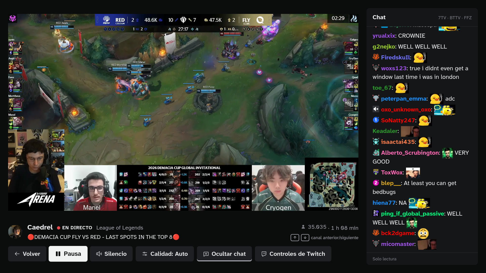

# GoodTTV

**English** · [Español](README.es.md)

A Twitch client for the TV, made to be used from the couch on a Linux mini PC with a small remote:
arrows, OK, Back and Play/Pause. Watch the live channels you follow, search for channels, and read
chat with **7TV, BTTV, FFZ** and Twitch emotes. Nothing else: no VODs, clips or categories.




[Demo video (84 s, remote keys only)](docs/media/demo.mp4) ·
[Search with the on-screen keyboard](docs/media/buscar.jpg) ·
[Quality chooser](docs/media/calidad.jpg)

The interface is in Spanish for now.

## Features

- **Guide-style home.** On the left, the channels you follow that are live, with viewers,
  category and uptime, then channels you watched recently and popular streams. On the right, a
  large preview of the focused channel.
- **Twitch's official player.** Nothing ever covers the video: controls and information sit
  below it and chat to its right. ↑/↓ switch channel without leaving playback, and Play/Pause
  always works.
- **Read-only chat of its own**, through EventSub. It shows Twitch, 7TV, BTTV and FFZ emotes
  (global and per channel), zero-width emotes, badges and mentions, in two text sizes.
- **Search** with an on-screen keyboard driven by the remote; a physical keyboard works too.
- **Back keeps your place.** Leaving playback returns focus to the channel you came from.
- **"Controles de Twitch".** An explicit mode to operate the player's own interface with the
  remote, for example to accept Twitch's "intended for certain audiences" notice.
- **Account linking from your phone**, with a QR code or a Twitch code. It only asks for
  read access: your follows and chat.
- **Remote test** in Settings: shows which key each button sends.

## Status

First release. [docs/verificacion.md](docs/verificacion.md) (in Spanish) separates what was
checked in a lab from what remains to be tested on the target hardware. The lab was an Arch
desktop with a virtual X11 display and real X11 key events.

In short:
- **Works with keys only:** open a channel → it plays → pause/resume → back → another channel,
  with real video up to 1920×1080.
- **Still to test:** HDMI audio, hardware video decoding, smoothness on the target mini PC, the
  physical remote, and suspend/resume.

Limits set by Twitch:
- Linking your account powers the follows list and chat. **The embedded player does not
  receive that session**, so Turbo and subscriber benefits do not apply.
- Twitch controls ads, availability and content gates. GoodTTV does not bypass them.

## Run it

You need Linux x86_64, Node.js 24 or later and Bun 1.4.2.

```bash
bun install --frozen-lockfile
bun run build && bun run start        # in a window, for testing
bun run package:appimage              # dist/GoodTTV-0.1.0-x86_64.AppImage, full screen
```

Prebuilt AppImages are attached to the [releases](https://github.com/mateozariquiey/GoodTTV/releases).
Development, tests, packaging and the Twitch Client ID are covered in
[docs/desarrollo.md](docs/desarrollo.md).

| Remote | Action |
| --- | --- |
| Arrows | Move. In the player, ↑/↓ switch channel |
| OK (Enter) | Select |
| Back (Escape, Back, Backspace) | Go back |
| Play/Pause (or Space) | Pause or resume, anywhere |

## Origin and changes

GoodTTV is a variant of [VacuumStream](https://github.com/eliottness/VacuumStream) 0.2.1 by
Eliott Bouhana, MIT licensed. This repository keeps its full history.

**Kept from VacuumStream:**
- The main process and its security model: isolation, checked IPC, and a local HTTPS server
  with a pinned certificate.
- Device sign-in and the token store.
- The Helix adapter and the Twitch SDK loader.
- The packaging with electron-builder.

**Changed:**
- A new, smaller interface built for a TV remote.
- Its own chat with third-party emotes, instead of Twitch's chat iframe.
- Every key goes through the main process, so focus inside Twitch's iframe can never take the
  remote away.
- Video start-up by script injection is gone; it is not needed.
- Back keeps your place in the list.
- Left out for now: VODs, resume, categories, favourites, captions, Steam Deck, Gamepad API
  and Flatpak.

The reasoning lives in [docs/decisiones.md](docs/decisiones.md) and the structure in
[docs/arquitectura.md](docs/arquitectura.md), both in Spanish.

## Contributing

Issues and pull requests are welcome. See [CONTRIBUTING.md](CONTRIBUTING.md) and, for security
reports, [SECURITY.md](SECURITY.md).

## License

[MIT](LICENSE), keeping VacuumStream's original attribution. Twitch is a trademark of Twitch
Interactive, Inc. GoodTTV is not affiliated with or endorsed by Twitch. Third-party emotes are
loaded from the public services of 7TV, BetterTTV and FrankerFaceZ.
